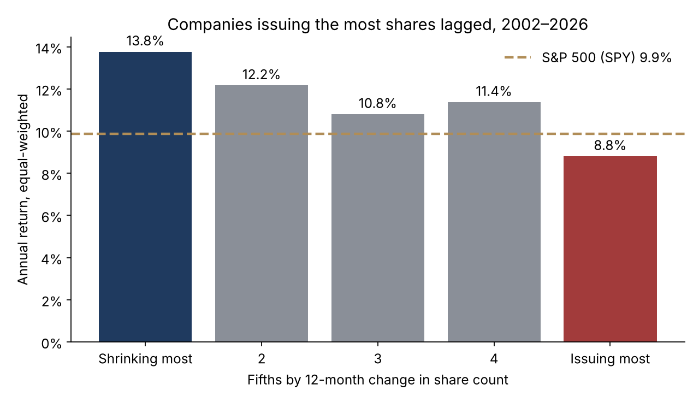
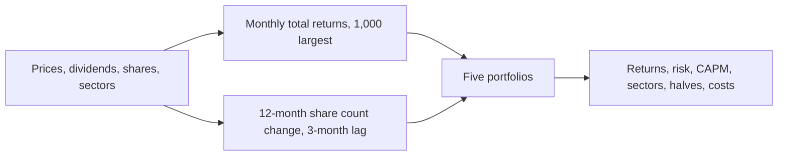

# Do buybacks still pay? Share counts and US stock returns, 2002–2026

About half of the largest US companies now shrink their share count each year, while the biggest technology firms are steering cash from buybacks into AI capex. This project tests whether a falling share count earns a premium, and whether heavy issuers should be avoided, on the 1,000 most traded US stocks each month from January 2002 to October 2026.

## Results

- **Direction clear, size modest.** The fifth shrinking its share count most (median −5.0% a year) returned 13.8% a year; the heaviest issuers (median +10.6%) 8.8%; all 1,000 stocks 11.5%; the S&P 500 (SPY) 9.9%. Value-weighted: 11.6% vs 7.9%.
- **Not reliable on its own.** The gap was 3.4 points a year (2.9 after costs, t = 1.3), paid in only 52% of calendar years, and leaned on 2021–22 (+37 and +44 points; 2020 was −29). Excluding 2020–22: 2.1 points (t = 1.0). Within sectors: 2.2 points (t = 0.9).
- **A risk signal.** Heavy issuers had beta 1.39 and 24% volatility (shrinkers 1.12 and 19%). Adjusted for market exposure the gap is 6.3 points a year (t = 2.5). The top-tenth issuers (median +21% shares a year) returned 7.4% a year.
- **Pre-registered hypotheses.** H1 (shrinkers beat issuers after costs): holds in direction, not in strength. H2 (survives beta and sectors): beta yes, sectors no. H3 (smaller after 2014): rejected (4.1 vs 2.7 points). H4 (driven by issuers): rejected (legs about equal, +1.9 and −1.5).



## The commercial case

| Element | What it is |
|---|---|
| Who pays | Equity PMs, multi-manager risk teams, allocators and wealth platforms |
| The problem | Heavy diluters ran with beta 1.39 and 24% volatility for 8.8% a year, against 11.5% for the average large stock |
| The product | A dilution and capital-return monitor: each holding's net issuance, its source and its risk, with flags for the heaviest issuers |
| Proof | 298 months, ~1,000 stocks a month, hypotheses fixed in advance, costs included |
| Build vs buy | 3–4 weeks on public data; most teams see share counts only inside composite scores |
| Pricing logic | $25–50k a year per client (illustrative): dropping the heaviest-issuing fifth added 0.56 points a year, $5.6m on a $1bn equal-weight book, before costs |
| Adoption risk | Modest, noisy edge: sell it as risk control; KPI is exposure to the heaviest-issuing tenth |

## Method

1. Universe: US operating companies (sector present, shell companies excluded); each month the 1,000 largest by trailing 12-month average daily dollar volume.
2. Signal: 12-month log change in split-adjusted shares outstanding, each count used three months after its report date.
3. Monthly total returns (price plus cash dividends); months with fewer than ten trading days or moves above +300% excluded.
4. Five equal-weighted portfolios each month (also value-weighted, sector-neutral and deciles), held one month.
5. CAPM regression on SPY; Newey-West t-statistics (6 lags); 10 bp per side on measured turnover (~10% a month per fifth).



## Run it

```
pip install -r requirements.txt
make ingest   # downloads the public files (~0.6 GB), checks sha256, builds the monthly panel
make run      # reports/metrics.json and reports/figures/*.png
make test
```

## Limits

- Survivorship: only companies listed today are in the mirror; failed issuers are missing, which likely understates the issuers' shortfall.
- Share counts are reported data from a public mirror; log changes of 2 or more in absolute value (about sevenfold) are excluded as errors.
- Net issuance mixes stock pay, offerings and stock-funded deals.
- One-factor market model; size, value and profitability are not separated.
- Independent research on public data; not deployed; not investment advice.

## Data and licences

- Prices, dividends, shares outstanding and company profiles: [huggingface.co/datasets/defeatbeta/yahoo-finance-data](https://huggingface.co/datasets/defeatbeta/yahoo-finance-data) (ODC-BY), pinned by sha256 in `configs/default.yaml`.

## References

- Pontiff, J. and Woodgate, A. (2008), "Share Issuance and Cross-Sectional Returns," *Journal of Finance* 63(2), 921–945.
- Daniel, K. and Titman, S. (2006), "Market Reactions to Tangible and Intangible Information," *Journal of Finance* 61(4), 1605–1643.
- Ikenberry, D., Lakonishok, J. and Vermaelen, T. (1995), "Market Underreaction to Open Market Share Repurchases," *Journal of Financial Economics* 39(2–3), 181–208.
- Loughran, T. and Ritter, J. R. (1995), "The New Issues Puzzle," *Journal of Finance* 50(1), 23–51.
- Newey, W. K. and West, K. D. (1987), *Econometrica* 55(3), 703–708.

Code MIT-licensed. Code, analysis, charts and text were produced with AI assistance (Claude, by Anthropic) and reviewed by Gaurav Gupta.
